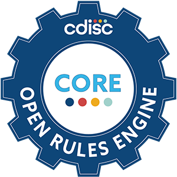

<p>
  <a href="https://www.cdisc.org"></a>
  <a href="https://www.verisian.com"></a>
</p>

# cdisc-rules-engine (Verisian fork)

[](https://www.python.org/downloads/release/python-3120)

This is Verisian's version ("fork") of the open source CDISC Rules Engine (CORE), a tool designed for validating clinical trial data against data standards. It runs the rules with an engine built on a PostgreSQL database.

The engine, and the rules it runs, are developed separately:

- **Standards**: the engine is built to support the SDTM and ADaM standards, i.e. validating data against the SDTM Implementation Guide (SDTMIG) and the ADaM Implementation Guide (ADaMIG).
- **Rules**: the rules are written and tested in the [core-contributor](https://github.com/verisianHQ/core-contributor) repository, which is their source of truth. The rules included in this repository come from there.
  - **SDTM**: the rules for SDTMIG 3.2, 3.3 and 3.4 are complete. They implement the CDISC [SDTM and SDTMIG Conformance Rules v2.0](https://www.cdisc.org/standards/foundational/sdtmig/sdtm-and-sdtmig-conformance-rules-v2-0) and the [FDA Business Rules v1.5](https://www.fda.gov/industry/fda-data-standards-advisory-board/study-data-standards-resources).
  - **ADaM**: the rules, based on the CDISC [ADaM Conformance Rules v5.0](https://www.cdisc.org/standards/foundational/adam/adam-conformance-rules-v5-0), are in development and will be released soon. Until then, a validation against ADaMIG (`-s adamig`) finds no rules to run.
  - **Define-XML**: the rules validating the Define-XML are also in development.

The engine is designed to support submissions of up to about 2.5 GB, though for best results datasets no larger than 1.5 GB are recommended. You can try larger submissions, but we cannot guarantee performance given the open source nature of the project. For production-sized submissions, Verisian offers a comprehensive submission analysis platform, which includes a fully integrated and hosted version of the CORE engine.

To learn more about Verisian, visit [Verisian's website](https://www.verisian.com).

To learn more about CDISC, visit the official [CDISC Website](https://www.cdisc.org/).

> [!TIP]
> Are you writing or testing rules? You don't need to set up this repository yourself: follow the [core-contributor](https://github.com/verisianHQ/core-contributor) guide instead, which installs and runs this engine for you.

## Contents

- [Quick start](#quick-start)
- [Before you start](#before-you-start)
- [Installation](#installation)
  - [1. Download the repository](#1-download-the-repository)
  - [2. Create a virtual environment](#2-create-a-virtual-environment)
  - [3. Install the requirements](#3-install-the-requirements)
  - [4. Choose a database](#4-choose-a-database)
  - [5. Add your CDISC Library API key (optional)](#5-add-your-cdisc-library-api-key-optional)
- [Running a validation](#running-a-validation)
  - [Validate a folder](#validate-a-folder)
  - [Validate specific datasets or rules](#validate-specific-datasets-or-rules)
  - [Validation options](#validation-options)
- [Understanding the report](#understanding-the-report)
- [Updating the cache](#updating-the-cache)
- [Other commands](#other-commands)
- [Custom standards and rules](#custom-standards-and-rules)
- [Troubleshooting](#troubleshooting)
- [Development](#development)
- [Submit an issue](#submit-an-issue)

## Quick start

If you already have Python 3.12 and Git installed, these commands install the engine and validate a folder of datasets (each step is explained in [Installation](#installation)):

**Mac / Linux**

```bash
git clone https://github.com/verisianHQ/cdisc-rules-engine
cd cdisc-rules-engine
python3.12 -m venv venv
source ./venv/bin/activate
python -m pip install -r requirements.txt
python core.py validate -s sdtmig -v 3-4 -d path/to/datasets
```

**Windows (PowerShell)**

```powershell
git clone https://github.com/verisianHQ/cdisc-rules-engine
cd cdisc-rules-engine
py -3.12 -m venv venv
.\venv\Scripts\Activate
python -m pip install -r requirements.txt
python core.py validate -s sdtmig -v 3-4 -d path\to\datasets
```

The report is written to the folder you ran the command from, as an Excel file named `CORE-Report-<date and time>.xlsx`.

## Before you start

The engine has no graphical interface: you run it by typing commands in a terminal (on Windows, PowerShell; on Mac, the Terminal app; or the terminal built into VSCode, for instance). Unless stated otherwise, every command below must be run from the folder of this repository (the `cdisc-rules-engine` folder created in [step 1](#1-download-the-repository)). Use `cd <path>` to move to it.

You need:

- **Python 3.12**. Check your version with `python --version` (on Mac and Linux, `python3 --version`). If you don't have Python 3.12, download and install it from [python.org](https://www.python.org/downloads/). On Windows, tick "Add python.exe to PATH" in the installer.
- **Git** (optional), to download the repository. You can get it from [git-scm.com](https://git-scm.com/downloads), or skip it and download the repository as a ZIP file instead (see [step 1](#1-download-the-repository)).

> [!NOTE]
> On Mac and Linux, if `python` is not found, use `python3` instead (e.g. `python3 core.py --help`). Once the virtual environment from [step 2](#2-create-a-virtual-environment) is active, `python` works on every system.

> [!NOTE]
> The Windows commands in this README are written for PowerShell. Most of them also work in Command Prompt, but some may need adjusting: if a command doesn't work in Command Prompt, try PowerShell instead.

[↑ Back to top](#contents)

## Installation

These steps only need to be done once.

### 1. Download the repository

In the terminal, navigate to the folder you want to install the engine in, then clone (download) the repository and move into it:

```bash
git clone https://github.com/verisianHQ/cdisc-rules-engine
cd cdisc-rules-engine
```

Without Git: on the [repository page](https://github.com/verisianHQ/cdisc-rules-engine), click **Code** → **Download ZIP**, unzip it, and `cd` into the unzipped folder.

### 2. Create a virtual environment

A "virtual environment" is a private copy of Python for this project, so that the packages the engine needs don't interfere with anything else on your computer.

1. **Create the virtual environment** (named `venv` here):

   Mac / Linux:

   ```bash
   python3.12 -m venv venv
   ```

   Windows:

   ```powershell
   py -3.12 -m venv venv
   ```

2. **Activate the virtual environment:**

   Mac / Linux:

   ```bash
   source ./venv/bin/activate
   ```

   Windows:

   ```powershell
   .\venv\Scripts\Activate
   ```

   When it is active, its name (`(venv)`) is shown in brackets at the start of the terminal line.

> [!IMPORTANT]
> You need to activate the virtual environment again (step 2 only) every time you open a new terminal.

<details>
<summary>Alternative: using <code>pyenv</code> (Mac / Linux)</summary>

If you already use `pyenv` to manage several Python versions, you can use it instead of the steps above (this needs the `pyenv-virtualenv` plugin):

```bash
pyenv install 3.12.5
pyenv virtualenv 3.12.5 venv_cdisc
pyenv local venv_cdisc
```

This creates a virtual environment named `venv_cdisc` based on Python 3.12.5 and automatically activates it whenever you are in this folder.

</details>

### 3. Install the requirements

With the virtual environment active, run:

```bash
python -m pip install -r requirements.txt
```

### 4. Choose a database

The engine stores the data it validates in a PostgreSQL database while it runs. You don't need to install PostgreSQL yourself: choose one of these two options.

#### Option A: temporary database (simplest)

Nothing needs to be set up: when the engine finds no `DATABASE_*` settings (in the environment or in a `./.env` file), it creates a temporary database for each run and deletes it at the end. The engine calls this an "in-memory Postgres instance" in its messages and options. You can also force it with the `-mem` flag, e.g. after setting up Option B.

#### Option B: Docker

Use this if you run many validations or want the database to keep running between runs.

1. Install and start the [Docker Desktop](https://www.docker.com/products/docker-desktop/) app.
2. Create the two required `.env` files by copying the example files and removing `.example` from the copy's name:
   - `./.env.example` → `./.env`
   - `./environment/local/.env.example` → `./environment/local/.env`
3. In `./environment/local/.env`, change `POSTGRES_DATA_DIR` to the folder where the database files should be stored (any empty folder on your computer).
4. The `DATABASE_*` variables in `./.env` tell the engine how to connect to the database and must match the `POSTGRES_*` values in `./environment/local/.env` (the example files already match, so you can leave them as they are).
5. Start the database, then go back to the root of the repository:

   ```bash
   cd ./environment/local
   docker compose up -d
   cd ../..
   ```

   The database keeps running in Docker Desktop until you stop it there.

6. From now on, the engine uses this database, because `./.env` contains the `DATABASE_*` settings. It must be running whenever you run a validation (or add `-mem` to use a temporary database instead).

### 5. Add your CDISC Library API key (optional)

The rules, controlled terminology and other standards metadata come with the repository, so you can skip this step to start with. You only need a CDISC Library API key to download the latest versions of them with [`update-cache`](#updating-the-cache).

To obtain an API key, please follow the instructions found here: <https://wiki.cdisc.org/display/LIBSUPRT/Getting+Started%3A+Access+to+CDISC+Library+API+using+API+Key+Authentication>. Please note it can take up to an hour after sign up to have an API key issued.

Store the key in the `./.env` file in the root of the repository (without quotation marks):

```
CDISC_LIBRARY_API_KEY=your-api-key
```

- **If you use Option B (Docker)**, `./.env` already exists: fill in the `CDISC_LIBRARY_API_KEY=` line at the bottom.
- **If you use Option A (temporary database)**, create a new, empty `./.env` file containing only the line above. Don't copy `./.env.example` for this: its `DATABASE_*` settings would make the engine look for the Docker database instead of creating a temporary one.

[↑ Back to top](#contents)

## Running a validation

Validations run on this fork's SQL engine by default, so no extra flag is needed. The engine validates XPT and SAS7BDAT files (they can be mixed in the same run); files in other formats, such as Dataset-JSON, are skipped with a warning.

> [!NOTE]
> The `--cdisc` flag runs the validation with the pandas engine originally developed by CDISC, which is still included in this repository. This part of the engine is not maintained in this fork, so the rest of this documentation doesn't cover it. To validate with the pandas engine, use the upstream [CDISC Rules Engine repository](https://github.com/cdisc-org/cdisc-rules-engine) instead, where it is maintained.

### Validate a folder

To validate all the datasets in a folder using rules for SDTM-IG version 3.4, use the following command (the database is chosen as described in [Choose a database](#4-choose-a-database)):

```bash
python core.py validate -s sdtmig -v 3-4 -d path/to/datasets
```

By default the report is written to the folder you run the command from, as an Excel (XLSX) file named `CORE-Report-<date and time>`; use `-o` and `-of` to change this (see [Validation options](#validation-options)).

**_NOTE:_** The rules, controlled terminology and other standards metadata are read from the cache in `resources/cache`, which is included in the repository. To refresh it with the latest data from the CDISC Library, see [Updating the cache](#updating-the-cache).

### Validate specific datasets or rules

Use `-dp` (once per file) instead of `-d` to validate specific dataset files, and `-r` (once per rule) to run only some of the rules:

```bash
python core.py validate -s sdtmig -v 3-4 -dp path/to/ae.xpt -dp path/to/dm.xpt -r CORE-000001
```

To run a rule from a local file (e.g. one you are writing) instead of the rules in the cache, use `-lr` with the path to the rule file, or to a folder of rule files:

```bash
python core.py validate -s sdtmig -v 3-4 -dp path/to/ae.xpt -lr path/to/rule.yml
```

If the rule uses an external dictionary, add its folder too, e.g. `--meddra path/to/meddra`.

**_NOTE:_** A local rule only runs if the standards listed under `Authorities` in the rule file include the standard and version given with `-s` and `-v`. Otherwise the engine skips it, and prints `No rules were found with the specified parameters` if no rule is left.

### Validation options

Run `python core.py validate --help` to see the full list of validation options. The ones you are most likely to need are:

**What to validate**

| Option                     | Description                                                                                                                                    |
| -------------------------- | ---------------------------------------------------------------------------------------------------------------------------------------------- |
| `-d`, `--data`             | Path to a folder of dataset files.                                                                                                             |
| `-dp`, `--dataset-path`    | Path to a dataset file. Can be specified multiple times. Cannot be used together with `-d`.                                                    |
| `-ft`, `--filetype`        | `xpt` or `sas7bdat`. Only validate dataset files with this extension, e.g. when the data folder holds both.                                    |
| `-s`, `--standard`         | **Required.** CDISC standard to validate against, e.g. `sdtmig`.                                                                               |
| `-v`, `--version`          | **Required.** Standard version to validate against, e.g. `3-4` for SDTMIG 3.4 (`3.4` works too).                                               |
| `-ss`, `--substandard`     | Substandard to validate against. Required for TIG: one of `SDTM`, `SEND`, `ADaM`, `CDASH`.                                                     |
| `-cs`, `--custom-standard` | Use a custom standard named by `-s` and `-v` that has been added to the cache (see [Custom standards and rules](#custom-standards-and-rules)). |

**Rules**

| Option                   | Description                                                                                           |
| ------------------------ | ----------------------------------------------------------------------------------------------------- |
| `-r`, `--rules`          | Only run this rule, e.g. `CORE-000001`. Can be specified multiple times.                              |
| `-er`, `--exclude-rules` | Don't run this rule, e.g. `CORE-000001`. Can be specified multiple times. Cannot be used with `-r`.   |
| `-lr`, `--local-rules`   | Path to a local rule file (YAML or JSON), or to a folder of them, to run instead of the cached rules. |

**Additional inputs**

| Option                                                              | Description                                                                                                                                                                                                                                                                                        |
| ------------------------------------------------------------------- | -------------------------------------------------------------------------------------------------------------------------------------------------------------------------------------------------------------------------------------------------------------------------------------------------- |
| `-dxp`, `--define-xml-path`                                         | Path to the Define-XML file.                                                                                                                                                                                                                                                                       |
| `-dv`, `--define-version`                                           | Define-XML version: `2-1`, `2-0`, `2.1` or `2.0`.                                                                                                                                                                                                                                                  |
| `-stf`, `--stf-file-path`                                           | Path to the study tagging file (STF).                                                                                                                                                                                                                                                              |
| `-ct`, `--controlled-terminology-package`                           | Controlled terminology package to validate against, e.g. `sdtmct-2024-03-29` (see [`list-ct`](#list-ct)). Can be specified multiple times. With a Define-XML 2.1 file, the engine uses the CT listed in the define, and `-ct` can't be used. With a Define-XML 2.0 file, give at most one package. |
| `--meddra`, `--whodrug`, `--loinc`, `--medrt`, `--unii`, `--snomed` | Path to the folder holding the files of that external dictionary.                                                                                                                                                                                                                                  |

**Report**

| Option                        | Description                                                                                                                                                                                                       |
| ----------------------------- | ----------------------------------------------------------------------------------------------------------------------------------------------------------------------------------------------------------------- |
| `-o`, `--output`              | Where to write the report, as a path ending in the file name, without the file extension. E.g. `-o reports/result` writes `result.xlsx` in the `reports` folder, relative to the folder you run the command from. |
| `-of`, `--output-format`      | `XLSX` (default), `CSV` or `JSON`. Can be specified multiple times. CSV writes one row per variable of each issue (Rule ID, Dataset, Record, Variable, Value, Message).                                           |
| `-rr`, `--raw-report`         | Write the JSON report in the raw format generated by the engine. Can only be used with `-of JSON`.                                                                                                                |
| `-rt`, `--report-template`    | Path to the Excel template to use for the XLSX report.                                                                                                                                                            |
| `--max-errors-per-dataset`    | The most issues a rule reports per dataset (per source file of a split dataset), with the message saying how many there were in total. Default: `50000`.                                                          |
| `--collapse-duplicate-issues` | When a rule's message applies to every record in a dataset, collapse those rows in the Excel report into a single row with the record numbers shown as a range (e.g. `1-500`), instead of one row per record.     |

**Display and database**

| Option                         | Description                                                                                                                                                   |
| ------------------------------ | ------------------------------------------------------------------------------------------------------------------------------------------------------------- |
| `-p`, `--progress`             | How to display progress: `bar` (default, e.g. `[████████████--------] 78%`), `percents`, `verbose_output` (prints rules as they are completed) or `disabled`. |
| `-l`, `--log-level`            | How much the engine logs (see [log levels](#log-levels) below). Disabled by default.                                                                          |
| `-mem`, `--in-memory-postgres` | Use a temporary database for this run, even if `DATABASE_*` settings are set (see [Choose a database](#4-choose-a-database)).                                 |
| `-ns`, `--sql-namespace`       | The prefix used for the database tables (default `uid`).                                                                                                      |
| `-ca`, `--cache`               | Path, relative to the repository, to the cache holding the rules and standards metadata (default `resources/cache`).                                          |

#### Log levels

- `debug` - Display all logs
- `info` - Display info, warnings, and error logs
- `warn` - Display warnings and errors
- `error` - Display only error logs
- `critical` - Display only critical error logs
- `disabled` - Disable engine logs (default)

[↑ Back to top](#contents)

## Understanding the report

The Excel report has these tabs:

- **Conformance Details** - details of the run: when it ran, how long it took, the engine version, and the standard, CT, Define-XML and dictionary versions used.
- **Dataset Details** - the datasets that were validated, with their label, location, size and number of records.
- **Issue Summary** - the number of issues found, per dataset and rule message.
- **Issue Details** - one row per issue found.
- **Rules Report** - the run status of each rule selected for validation.

### Rule statuses

The possible rule run statuses in the Rules Report are:

- `EXECUTION ERROR` - The rule ran into an error and couldn't finish running on at least one dataset, or the rule itself is invalid (`Invalid rule structure`).
- `ISSUE REPORTED` - The rule ran and found issues, which are listed in the Issue Summary and Issue Details tabs.
- `SUCCESS` - The rule ran and found no issues.
- `SKIPPED` - The rule didn't run on any dataset. Either no dataset was in its scope (e.g. `Rule skipped - doesn't apply to domain`), or it needs an input that wasn't given (a define.xml with `-dxp`, a study tagging file with `-stf`, or an external dictionary such as `--meddra`), in which case the reason starts with `Not applicable: requires`.

A rule runs on each dataset separately, so its datasets can end up with different statuses. The rule then shows the highest-priority one: `EXECUTION ERROR` > `ISSUE REPORTED` > `SUCCESS` > `SKIPPED`.

### The Reason column

The `Reason` column within the Rules Report explains `SKIPPED` and `EXECUTION ERROR` rules, naming the affected datasets in brackets. Reasons are listed in this order:

1. Execution errors, e.g. `SQL operator execution error: ... (AE)`
2. Datasets where issues were reported, as `Issues reported (DM)`
3. Skips with a cause, such as a missing variable or a missing define.xml
4. Datasets out of the rule's scope, e.g. `Rule skipped - doesn't apply to domain (LB, QS)`. These are only shown for `SKIPPED` rules; next to an error they're left out.

A skip with a cause names the datasets it hit, unless it hit every one of several in-scope datasets (e.g. a define.xml missing for the whole study), in which case the list is left out because it would add nothing.

[↑ Back to top](#contents)

## Updating the cache

When running a validation, CORE uses the rules, controlled terminology, standards metadata, etc. stored in the cache (`resources/cache`), unless `-lr` is specified. To update the cache with the latest data from the CDISC Library, run:

```bash
python core.py update-cache
```

This needs a CDISC Library API key, stored in the `./.env` file as described in [step 5](#5-add-your-cdisc-library-api-key-optional) (or given with the `--apikey` option).

[↑ Back to top](#contents)

## Other commands

### version

Print the version of the engine:

```bash
python core.py version
```

### list-rules

List the published rules available in the cache:

- list all published rules:

  ```bash
  python core.py list-rules
  ```

- list rules for a standard:

  ```bash
  python core.py list-rules -s sdtmig -v 3-4
  ```

- list rules for an integrated standard (substandard: `SDTM`, `SEND`, `ADaM`, `CDASH`):

  ```bash
  python core.py list-rules -s tig -v 1-0 -ss SDTM
  ```

- list rules by ID:

  ```bash
  python core.py list-rules -r CORE-000351 -r CORE-000591
  ```

- list all custom rules:

  ```bash
  python core.py list-rules --custom-rules
  ```

- list custom rules for a custom standard:

  ```bash
  python core.py list-rules --custom-rules -s custom_standard -v 1-0
  ```

### list-rule-sets

List all standards and versions for which rules are available:

```bash
python core.py list-rule-sets
```

To list custom standards and versions instead:

```bash
python core.py list-rule-sets --custom
# or using the short form:
python core.py list-rule-sets -o
```

### list-ct

List the controlled terminology (CT) packages available in the cache, e.g. to find the name to give `-ct`:

```bash
python core.py list-ct
```

Add `-s sdtmct` (can be specified multiple times) to only list packages of one type.

### list-dataset-metadata

List the metadata (domain, filename, full path, file size, label, modification date) of the given datasets:

```bash
python core.py list-dataset-metadata -dp path/to/ae.xpt -dp path/to/ex.xpt
```

By default this uses the SQL engine, which reads XPT and SAS7BDAT. Add `--cdisc` to use the CDISC (pandas) engine for other formats such as Dataset-JSON.

> All the commands that read the cache (`list-rules`, `list-rule-sets`, `list-ct`, `update-cache`) accept `-c` / `--cache-path` to use a cache other than `resources/cache`.

[↑ Back to top](#contents)

## Custom standards and rules

You can add your own rules to the cache, and group rules into your own "custom standards" to validate against. Custom rules are identified by their core ID (e.g. `COMPANY-000123` or `CUSTOM-000123`).

These commands don't need a CDISC Library API key.

> [!TIP]
> You don't have to add custom rules to the cache or attach them to a custom standard to run them: pass the folder (or file) holding your custom rules with `-lr` instead, as described in [Validate specific datasets or rules](#validate-specific-datasets-or-rules):
>
> ```bash
> python core.py validate -s sdtmig -v 3-4 -d path/to/datasets -lr path/to/custom_rules
> ```
>
> Each rule still needs to list the standard and version given with `-s` and `-v` under `Authorities`.

### Custom rules

- **Add custom rules**: Use the `--custom-rules-directory` or `-crd` flag to specify a directory containing local rules, or `--custom-rule` or `-cr` flag to specify a single rule file:

  ```bash
  python core.py update-cache --custom-rules-directory 'path/to/directory'
  python core.py update-cache --custom-rule 'path/to/rule.json' --custom-rule 'path/to/rule.yaml'
  ```

- **Update a custom rule**: Use the `--update-custom-rule` or `-ucr` flag to update an existing rule in the cache:

  ```bash
  python core.py update-cache --update-custom-rule 'path/to/updated_rule.yaml'
  ```

- **Remove custom rules**: Use the `--remove-custom-rules` or `-rcr` flag to remove rules from the cache. Can be a single rule ID, a comma-separated list of IDs, or ALL to remove all custom rules:

  ```bash
  python core.py update-cache --remove-custom-rules 'RULE_ID'
  python core.py update-cache --remove-custom-rules 'RULE_ID1,RULE_ID2,RULE_ID3'
  python core.py update-cache --remove-custom-rules ALL
  ```

### Custom standards

A custom standard maps a standard name and version to the list of rules to run for it. It can list both CDISC rules and your own custom rules, so you should first add your custom rules to the cache, then create a custom standard that references them.

- To add a custom standard, you need a JSON file with the following structure, listing as many rule IDs as you need:

  ```json
  {
    "standard_id/version": ["RULE_ID1", "RULE_ID2", "RULE_ID3"]
  }
  ```

  For example:

  ```json
  {
    "cust_standard/1-0": [
      "CUSTOM-000123",
      "CUSTOM-000456",
      "CUSTOM-001",
      "CUSTOM-002"
    ]
  }
  ```

- To add or update a custom standard, use:

  ```bash
  python core.py update-cache --custom-standard 'path/to/standard.json'
  ```

- To remove custom standards, use the `--remove-custom-standard` or `-rcs` flag:

  ```bash
  python core.py update-cache --remove-custom-standard 'mycustom/1-0'
  ```

- To validate against a custom standard, add the `-cs` flag to the validate command, with the custom standard's name and version as `-s` and `-v`:

  ```bash
  python core.py validate -cs -s cust_standard -v 1-0 -d path/to/datasets
  ```

  The engine uses the custom standard to look up which rules to apply from the cache. Custom standards which match CDISC standard names and versions can be used to get library metadata for the standard while still using custom rules. If a custom name does not match a CDISC standard, library metadata will not be populated. For example, this standard gets its metadata from SDTMIG version 3.4, but runs only the custom rules listed:

  ```json
  {
    "sdtmig/3-4": ["CUSTOM-000123", "CUSTOM-000456", "CUSTOM-001", "CUSTOM-002"]
  }
  ```

[↑ Back to top](#contents)

## Troubleshooting

<details>
<summary><code>python</code> is not found, or <code>python --version</code> shows the wrong version</summary>

On Mac and Linux, use `python3` (or `python3.12`) instead of `python`. On Windows, use `py -3.12`, or reinstall Python from [python.org](https://www.python.org/downloads/) with "Add python.exe to PATH" ticked. Once the [virtual environment](#2-create-a-virtual-environment) is active, `python` is always the right version.

</details>

<details>
<summary>Windows: "running scripts is disabled on this system" when activating the virtual environment</summary>

PowerShell blocks scripts by default. Allow them for your user by running this once, then activate the virtual environment again:

```powershell
Set-ExecutionPolicy -Scope CurrentUser RemoteSigned
```

</details>

<details>
<summary>"No module named ..." when running a command</summary>

The virtual environment is probably not active: [activate it](#2-create-a-virtual-environment) (its name should appear in brackets at the start of the terminal line) and try again. If it is active, install the requirements again with `python -m pip install -r requirements.txt`.

</details>

<details>
<summary>"No DATABASE_* settings found ... using an in-memory Postgres instance instead"</summary>

This is expected if you use [Option A](#option-a-temporary-database-simplest): the engine creates a temporary database for the run. If you meant to use the Docker database ([Option B](#option-b-docker)), check that `./.env` exists in the root of the repository and contains the `DATABASE_*` settings.

</details>

<details>
<summary>The engine can't connect to the database</summary>

If you use [Option B](#option-b-docker), check that Docker Desktop is running and that the database is started (run `docker compose up -d` from `./environment/local`), and that the `DATABASE_*` settings in `./.env` match the `POSTGRES_*` settings in `./environment/local/.env`. To run without Docker, add `-mem` to the command.

</details>

<details>
<summary><code>docker compose up</code> fails with "port is already allocated" or "container name is already in use"</summary>

Another database is already using port 5432, or a database container from an earlier set-up is still there. If it is an earlier CORE database, start it from Docker Desktop instead. Otherwise, choose another port (e.g. `5433`) for both `POSTGRES_PORT` in `./environment/local/.env` and `DATABASE_PORT` in `./.env`, and run `docker compose up -d` again.

</details>

<details>
<summary>"Skipping files the SQL engine can't read" or "No dataset files to validate"</summary>

The engine validates XPT and SAS7BDAT files only. Check that `-d` points to the folder holding your `.xpt` or `.sas7bdat` files, or that `-dp` points to such a file.

</details>

<details>
<summary>"Unknown value Class in ValueSet" when using a Define-XML 2.0 file</summary>

The engine expects the dataset classes in a Define-XML 2.0 file (the `def:Class` values) in upper case, e.g. `SPECIAL PURPOSE` or `TRIAL DESIGN`, not `Special Purpose`. Correct them in the define.xml and run the validation again.

</details>

<details>
<summary><code>update-cache</code> fails with "Missing option '--apikey'"</summary>

Add your CDISC Library API key to `./.env` as described in [step 5](#5-add-your-cdisc-library-api-key-optional), or give it with `--apikey`.

</details>

[↑ Back to top](#contents)

## Development

If you want to change the engine itself (code formatting, running the tests, building an executable or a package), see [DEVELOPMENT.md](DEVELOPMENT.md).

## Submit an issue

If you encounter any bugs, have feature requests, or need assistance, please submit an issue on our GitHub repository:

[https://github.com/verisianHQ/cdisc-rules-engine/issues](https://github.com/verisianHQ/cdisc-rules-engine/issues)

When submitting an issue, please include:

- A clear description of the problem or request
- Steps to reproduce the issue (for bugs)
- Your operating system and environment details
- Any relevant logs or error messages

[↑ Back to top](#contents)
